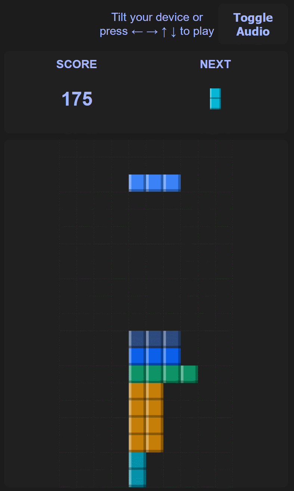
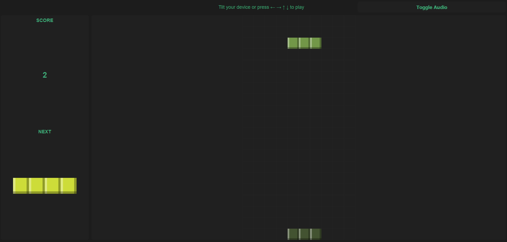

Accel Tetris
===

This is a tetris like game implemented in the browser through plain
html/css/javascript.



For controls, the game is designed to be controlled by tilting the
device to move the bricks left or right. A tilt downward will speed
up the movement.

Because of the tilt controls, there is no way to rotate bricks.
The classic bricks are frustrating without rotations, which is why
custom bricks are used here.

After a 1000 points, the theme of the game will change, and with it,
the kind of bricks change as well. There is a small chance that on a level
change, the board will be cleared of all bricks.

On PC the game can be controlled through the arrow keys.



# Audio

The game features an optional audio button that will play
the tetris music.

The music is from https://pixabay.com/music/classical-piano-tetris-theme-korobeiniki-arranged-for-piano-186249/

# How to run?

The game can be run on a regular webserver.

For example to host it on a PC:
```bash
> python -m http.server
Serving HTTP on :: port 8000 (http://[::]:8000/) ...
```
Then open the page: http://127.0.0.1:8000/

Depending on how you configured your firewall, you can even access
the page over the same network by using the PCs IP + the port the webserver
exposes.

Note that the sensor API requires a secure connection (https)
which the browser enforces. On iOS devices there will appear an extra button
on the left that has to be clicked to grant permissions for using the sensors.

It doesn't seem to be possible to do this automatically on page load, hence
the extra button.

When hosting locally, you can work around this, by doing the following:
1. Type `chrome://flags` as the website,
2. then search for "Insecure origins treated as secure"
3. where you enter the PCs IP adress + Port.
   For example you would enter `http://192.168.178.92:8000`.

